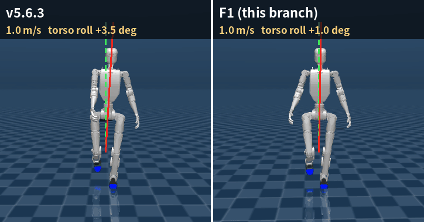
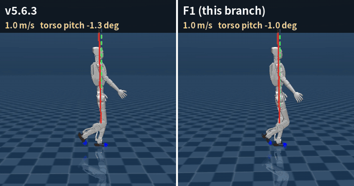

# K1 ankle roll as a passive spring (k1_mp_gait56_ankle_spring)

v5.6.3 (k1_mp_gait56) variant in which the ankle **roll** joints have no motor and act as a
passive spring-damper (K = 10 Nm/rad, D = 0.6 Nms/rad). Policies were PPO fine-tuned from v5.6.3.

## 姿勢の比較 / Posture comparison (v5.6.3 | F1, 1.0 m/s)



緑の破線は鉛直線、赤い線は胴体（torso_link）の軸です。上の数字は1台ぶんの瞬間値です。
32台・10秒の評価では、上体の傾き RMS は v5.6.3 が 3.16 / 3.21 / 3.24°、F1 が 1.20 / 1.17 / 1.62°（0.6 / 1.0 / 1.4 m/s）、
骨盤ロール RMS は v5.6.3 が約 3.0°、F1 が 0.8〜0.9° です。差はほとんど左右方向（正面図）で、前後の傾き（側面図）はどちらも小さく同程度です。

Green dashed line: world vertical; red line: torso (torso_link) axis. Overlay numbers are single-robot instantaneous values.
Measured (32 robots x 10 s): torso tilt RMS v5.6.3 3.16 / 3.21 / 3.24 deg vs F1 1.20 / 1.17 / 1.62 deg (0.6 / 1.0 / 1.4 m/s);
pelvis roll RMS ~3.0 deg vs 0.8-0.9 deg. The difference is almost entirely lateral (front view); fore-aft pitch (side view) is small for both.

## Policies (runs/final_spring/)
| file | use | notes |
|---|---|---|
| `walk_Qup075.pt` | walking | level pelvis + relaxed arms (stage Q_up075 it100). **Adopted setting = F1: this same checkpoint run with ANK_K=20 ANK_D=0.3** |
| `run_K10_D0.6.pt` | running | frozen (it1400); also used unchanged with the F1 ankle spring (K=20, D=0.3) |

`runs/final/` and `runs/init/` are the unchanged v5.6.3 policies used as the baseline / warm start (not in this branch).

## F1 = adopted walking setting (ankle roll K = 20 Nm/rad, D = 0.3 Nms/rad, zero-shot)
F1 uses the committed `walk_Qup075.pt` without retraining; only the passive ankle-roll spring is stiffer
(phase-2 sweep: power fell monotonically with K up to K20, D 0.3-1.0 mattered little).
```
ANKLE_SPRING=1 ANK_K=20 ANK_D=0.3 \
ARM_KPM=0.25 REF_LIB=ref_lib_56_w11_sym.npz REF_W=0.11 \
python3 eval_spring.py runs/final_spring/walk_Qup075.pt runs/final_spring/run_K10_D0.6.pt --n 32 --meas 10 --straight
```
or simply `./eval_F1.sh` (same command; extra arguments are passed through, e.g. `./eval_F1.sh --profile`).
`ARM_KPM=0.25` (arm servo gain x0.25), `ANK_K` / `ANK_D` and the reference are **not stored in the checkpoint** and must be set.
The 11 cm stance reference is `ref_lib_56_w11_sym.npz` (`make_ref56.py`, `make_sym_ref.py`).
The original Q_up075 setting (K = 10, D = 0.6) is the same command with `ANK_K=10 ANK_D=0.6`.

## Results vs v5.6.3 (32 robots, 10 s, straight; power interpolated to the same actual speed)
| command | 0.6 m/s | 1.0 m/s | 1.4 m/s |
|---|---|---|---|
| v5.6.3 actual speed (ratio to command) | 0.573 (95.5 %) | 0.968 (96.8 %) | 1.335 (95.4 %) |
| **F1** actual speed (ratio) | 0.628 (104.7 %) | 1.044 (104.4 %) | 1.387 (99.1 %) |
| **F1** power vs v5.6.3 | +12.1 % | +6.7 % | +8.7 % |
| F1 absolute power | 112.3 W | 146.1 W | 190.4 W |
| F1 pelvis roll RMS (v5.6.3 ~3.0 deg) | 0.82 deg | 0.93 deg | 0.93 deg |
| F1 torso tilt RMS (v5.6.3 3.16 / 3.21 / 3.24 deg) | 1.20 deg | 1.17 deg | 1.62 deg |
| Q_up075 (K10 D0.6) power vs v5.6.3, for reference | +12.9 % | +7.9 % | +9.5 % |

- F1 pushed walking: 0 / 0 / 0 falls in 128 at 0.6 / 1.0 / 1.4 m/s (Q_up075: 1 / 0 / 0, v5.6.3: 3 / 2 / 1).
- F1 pushed hard brake survival (0.6 / 1.0 / 1.4 / 1.65 m/s): 98.4 / 96.9 / 100 / 98.4 %.
- 12 test cases (walk, walk turns, in-place turn, run 2.5-4.5 m/s, run turns) + stand-walk-run-walk-stop profile: all survive;
  the frozen run policy runs 0.4-0.9 % lower power at K20 D0.3 (running not retrained).
- Arms: unchanged from Q_up075 (no arm-body contact); arm power 1.8 / 2.7 / 4.4 W.

## v5.6.3 の省エネについて（正直なまとめ） / Honest note on v5.6.3's energy saving
**日本語**
- v5.6.3 の省エネ効果は、ロッカーファンクション（かかと→足首→前足部→つま先の転がり）によるものではありませんでした。
  ロッカー機能は今回の版でもすでに出ていて（かかと接地、足裏の圧力中心の滑らかな移動、反対脚の接地直前の蹴り出し）、差を生んでいませんでした。
- 効いていたのは**股関節（股関節ロール）の脱力**です。v5.6.3 は骨盤・上体を立脚側へ約 3° 傾けて沈ませることで、立脚側の股関節ロールの保持トルクを減らしていました。
  - 立脚期の股関節ロールトルク：v5.6.3 は 21〜24 Nm、骨盤を水平に保つと約 30 Nm（股関節ロール軸は骨盤中心から 12.5 cm 外側、上半身は約 19 kg）。
  - 股関節ロールの銅損（1.0 m/s）：v5.6.3 は 31.2 W、骨盤水平の M_c1 は 56.5 W。この約 +26 W が電力差のほぼ全部です。
  - 骨盤を水平に保った版では、股関節ロールが歩行電力の約 4 割を占めます（1.0 m/s で 58.3 W / 148.1 W）。
  - その代わり v5.6.3 は骨盤ロール RMS 約 3.0°、上体傾き RMS 3.16 / 3.21 / 3.24° と大きく揺れます（この版は骨盤 0.8〜0.9°、上体 1.2〜1.6°）。
- このままリアルのロボットに落とし込むと、頭部・胴体の揺れと傾きがカメラ映像と IMU に悪影響を与えます。
  そこでこの版では**姿勢（上体を垂直、骨盤を水平）を優先し、電力の増加（v5.6.3 比 +7〜12 %）を受け入れました**。
- 指令速度の追従は 98 % 以上を守っています（v5.6.3 自体は 95〜97 % で指令より遅く歩いています）。電力は同じ実速度に補間して比較しています。
- 姿勢を保ったまま電力を下げようとして試したが、効かなかったもの（数値は v5.6.3 比、または F1 比、0.6 / 1.0 / 1.4 m/s）：
  - 腰ロール軸の追加（+0.7 kg）：+20.9 / +15.6 / +18.9 %（同じ重さを足して軸を固定した版でも +17.4 / +12.0 / +12.7 %）。姿勢は良くなるが省エネにはならない。
  - 股関節ロールの硬さ（kp）の調整：上げると骨盤が揺れ、下げると電力が増えるか転倒するため、元の値のまま。
    股関節ロールの基準角度 x0.75 + 少し広いスタンス：+9.9 / +5.6 / +8.8 % だが、大半は 2〜3 % 速く歩いた分で、同じ指令での実電力はほぼ同じ。
  - 足首ピッチのクラッチ付き並列バネ（Collins 型）：一番良い物理的に正しい版（0.1 kg、ひざ寄りに搭載）でも F1 比 −3.7 / −0.5 / +1.7 ポイント、0.2 kg では悪化。
    K1 はクラッチがつながる角度より上で蹴り出すため、バネにたまるのは 1 歩 0.1〜0.7 J（足首モーターの仕事は 17〜24 J）だけ。
  - 骨盤ロールを 1.5° まで許す追加学習：F1 比で最大 −2.5 / +0.8 / −1.4 ポイント（骨盤ロール 1.52°、上体傾きも上限ぎりぎり）。全条件を満たす版は +0.1 / −0.6 / −1.1 ポイントで、学習のばらつきの範囲内。

**English (summary)**
- v5.6.3's lower power did not come from the rocker function (this variant already shows heel strike, smooth CoP progression
  and pre-emptive push-off). It came from **relaxed hip holding**: v5.6.3 lets the pelvis/torso sag ~3 deg over the stance leg,
  so the stance hip roll holds 21-24 Nm instead of ~30 Nm with a level pelvis (hip-roll copper 31.2 W vs 56.5 W @1.0 m/s,
  the whole ~+26 W gap; hip roll is ~40 % of walking power with a level pelvis).
- On a real robot that sway/tilt (pelvis roll ~3.0 deg, torso tilt ~3.2 deg RMS) would hurt the camera and IMU, so this variant
  prioritises posture and accepts +7..+12 % power, while tracking >= 98 % of the commanded speed (v5.6.3: 95-97 %).
- Tried without success: waist-roll axis (+0.7 kg), hip-roll kp / reference tuning, clutched ankle-pitch spring,
  allowing 1.5 deg pelvis roll (numbers above; details in `NOTES_ANKLE_SPRING.md`).

## Caveats
- Arm gearbox back-drive friction is not modelled; relaxed arms may swing less on hardware.
- Details and the full training history: `NOTES_ANKLE_SPRING.md`.
